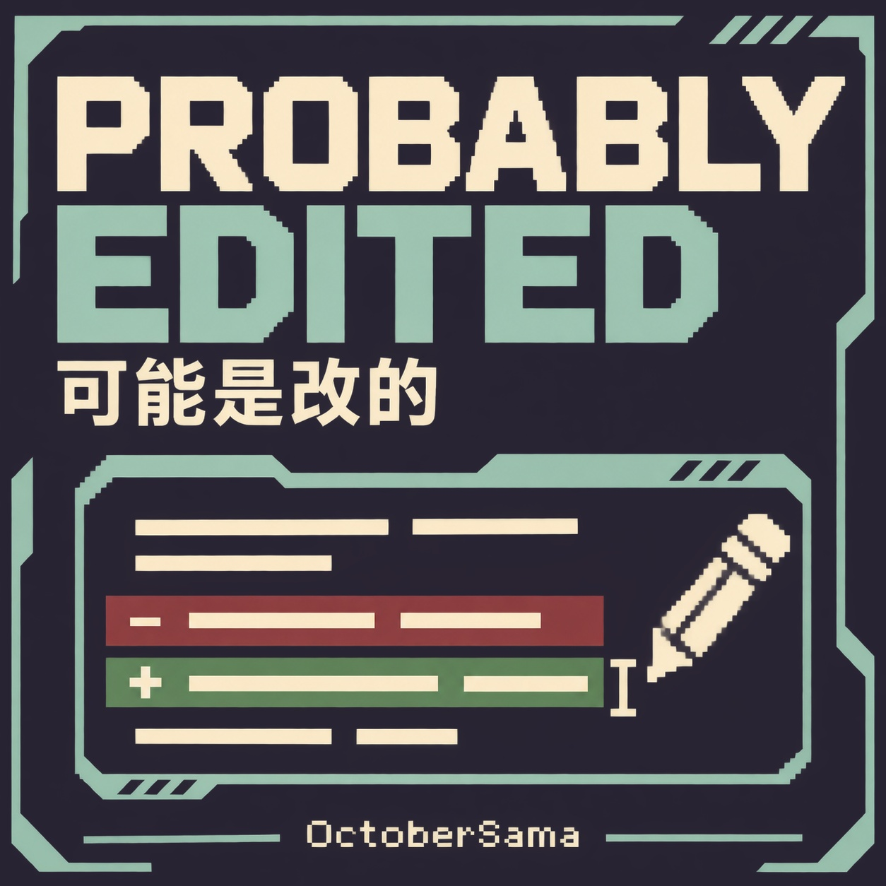

# 可能是改的 / Probably Edited

<p align="center">
  
</p>

在《深空当铺：可能是偷的》（Probably Stolen）里直接修改游戏和模组的文字。你可以用最多 36 套多语言预设保存不同改法，对照原文查看差异，也能导出文件分享给别人。修改单独保存，不会改写游戏文件。

## 界面演示

<p align="center">
  <a href="docs/assets/editor-overview.png"></a>
</p>

点击演示图可查看原图。

## 安装与打开

1. 先准备字体依赖 [ProbablyFonts](https://github.com/Octobersama/ProbablyFonts) 和本模组的安装包，把两个模组文件夹放进游戏的 `Mods/`。自己编译时，分别复制两个项目生成的整个 `dist/ProbablyFonts/` 和 `dist/ProbablyEdited/` 文件夹，不要只复制 DLL。
2. 在游戏模组列表中依次启用 **ProbablyFonts** 和 **可能是改的 / Probably Edited**，然后重启游戏。
3. 回到主菜单的模组列表，选中 **可能是改的 / Probably Edited**，点击设置齿轮即可打开编辑器。

如果想在游玩途中打开编辑器，推荐安装 [游戏内模组设置 / In-Game Mod Settings](https://steamcommunity.com/sharedfiles/filedetails/?id=3834556946)。没有它，也能从主菜单打开。

游戏只会提示缺少依赖，不会自动替你安装；Steam 也不会自动订阅依赖。请先装好并启用 ProbablyFonts。

## 编辑与分享

### 修改文字

1. 选择或新建一套预设，再选择要修改的语言和文本来源。
2. 在左侧找到条目，在右侧输入替换文字。红底表示删去的部分，绿底表示新增的部分。
3. 点击 **暂存此条**，再继续修改其他条目。暂存只是先记住这次修改，还没有写入文件。
4. 修改完成后点击 **保存并应用**：保存所有预设的草稿，但只让当前选中的预设生效。

切换预设或文本语言只是在切换编辑对象，不会马上替换游戏文字，也不会改变游戏语言。输入框右键可以全选、复制、粘贴、撤销和重做。

想换编辑器自身的显示语言，请到游戏 **选项 → Probably Edited · 界面 → 模组界面语言** 中设置；默认跟随游戏。

### 导出给别人

选择要分享的预设，点击 **导出** 并填写文件名。一次只导出一套预设，生成的 JSON 文件位于：

```text
%USERPROFILE%\AppData\LocalLow\Questing Goose Studio\Probably Stolen\ModData\probably_edited\exports\
```

把生成的 `.json` 文件发给对方即可。对方也需要安装本模组。

### 导入别人分享的预设

1. 把收到的 `.json` 文件放进下面的数据目录，也可以放进它的子文件夹：

   ```text
   %USERPROFILE%\AppData\LocalLow\Questing Goose Studio\Probably Stolen\ModData\probably_edited\
   ```

2. 在编辑器点击 **导入**，刷新文件列表并选择这个文件。
3. 选择新建预设或合并到已有预设，核对预览。遇到同一条文字有不同修改时，选择保留自己的内容还是采用导入内容。
4. 确认导入后，再点击 **保存并应用**，修改才会保存并生效。

以上是 Windows 数据路径，可以直接粘贴到资源管理器地址栏。`%USERPROFILE%` 会自动替换为你的用户目录，无需填写系统用户名。非 Windows 系统以导入窗口显示的目录为准。

数据目录里的 `presets.json` 是全部预设的本地存储文件，不是分享文件；分享时请使用 **导出** 生成的 JSON。

需要手工编辑 JSON 或了解字段含义时，参阅技术说明：[简体中文](docs/zh-CN/preset-format.md) · [正體中文（臺灣）](docs/zh-TW/preset-format.md) · [English](docs/en-US/preset-format.md)。

## 构建

需要 .NET SDK 和本机安装的游戏；编译时从游戏目录引用程序集，不会把游戏程序集打进模组包。构建产物位于 `dist/ProbablyEdited/`，安装时复制完整文件夹。

```powershell
dotnet build ProbablyEdited.csproj -c Release
```

游戏安装在非默认位置时，指定 `GameDirectory`：

```powershell
dotnet build ProbablyEdited.csproj -c Release -p:GameDirectory="D:\SteamLibrary\steamapps\common\Probably Stolen"
```

GitHub Actions 会在推送提交、提交 pull request 或手动运行时，用 .NET 10 执行 5 个检查项目，不需要安装游戏。运行结束后，可以在 Actions 页面下载 `ProbablyEdited-console-check-results`，里面是测试日志和 `summary.txt`。这些是检查结果，不是模组安装包；完整安装包仍需在装有游戏的本机按上述命令构建。

提交信息含 `[skip ci]`、`[ci skip]`、`[no ci]`、`[skip actions]` 或 `[actions skip]` 时，GitHub 会跳过对应的自动工作流；手动运行不受这些标记影响。

项目源码：[ProbablyEdited](https://github.com/Octobersama/ProbablyEdited)。

## 覆盖范围与兼容性

- 编辑器枚举游戏原生本地化表，以及已启用模组通过官方系统加载的 `Localization` 字典。代码中写死的文字、自建文本系统和动态生成内容不一定能通用枚举。
- 空字符串仍遵循游戏原有的 Unity 语言回退行为，不保证强制隐藏文字。
- 模组以 `netstandard2.1` 为目标；`manifest.xml` 当前声明游戏版本 `0.46D` 和 `1.0.0`。版本声明不替代对目标客户端的实机验证，游戏更新也可能改变可用接口。

## 许可证

Copyright © 2026 OctoberSama。项目代码、文档和原创封面采用 [Apache License 2.0](LICENSE)，署名见 [NOTICE](NOTICE)。演示截图中的原游戏内容及游戏字体仍属于原权利人，本项目许可不授予这些资产的再分发权。
