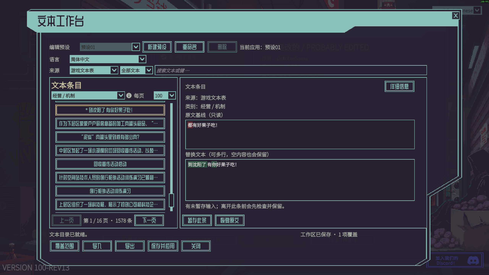

# 可能是改的 / Probably Edited
版本 1.0.0 · 作者 OctoberSama

为《深空当铺：可能是偷的》（Probably Stolen）提供游戏内本地化编辑器：浏览游戏及已启用模组的本地化文本，以最多 36 个可改名的多语言预设管理修改、对照差异并分享单预设 JSON。修改以独立覆盖保存，不改写游戏文件。



## 安装与打开

1. 先安装并启用 [ProbablyFonts](https://github.com/Octobersama/ProbablyFonts)：把它构建出的整个 `dist/ProbablyFonts/` 文件夹复制到游戏的 `Mods/`，在模组列表启用并重启游戏。
2. 将本项目构建出的整个 `dist/ProbablyEdited/` 文件夹也复制到 `Mods/`，启用后重启。主菜单打开模组列表，选中 **可能是改的 / Probably Edited** 并点击设置齿轮。
3. 想在游玩中从原生“选项”进入模组设置，可另外安装推荐整合 [游戏内模组设置 / In-Game Mod Settings](https://steamcommunity.com/sharedfiles/filedetails/?id=3834556946)。没有它仍可从主菜单打开编辑器。

清单中的先决项由原生模组加载器仅作缺失提示，不会由本模组在运行时强制拦截；Steam 也不会自动订阅或安装它们。请先手动安装并启用字体前置 `probably_fonts`；`asteroid_in_game_mod_settings` 仅用于游玩中打开设置，是推荐整合。

## 编辑与分享

选择预设、语言和文本来源后即可编辑。切换预设或文本语言只改变编辑对象，不会立即切换生效内容或游戏语言。点 **暂存此条**保留当前输入，再点 **保存并应用**保存全部预设草稿，并仅应用当前选中的预设。

模组界面语言在游戏 **选项 → Probably Edited · 界面 → 模组界面语言** 中设置，默认跟随游戏；它与正在编辑的文本语言独立。输入框右键支持全选、复制、粘贴和分组撤销／重做。

- **导出**：选择预设并点击导出，文件保存到模组数据目录的 `exports/` 下，一次只导出一个预设。
- **导入**：把 JSON 放进导入窗口显示的数据目录或其子目录，刷新列表，选择新预设或已有预设作为目标，核对预览和冲突后确认；随后点击 **保存并应用**。

JSON 技术说明：[简体中文](docs/zh-CN/preset-format.md) · [正體中文（臺灣）](docs/zh-TW/preset-format.md) · [English](docs/en-US/preset-format.md)。

## 构建

需要 .NET SDK 和本机安装的游戏；编译时从游戏目录引用程序集，不会把游戏程序集打进模组包。构建产物位于 `dist/ProbablyEdited/`，安装时复制完整文件夹。

```powershell
dotnet build ProbablyEdited.csproj -c Release
```

游戏安装在非默认位置时，指定 `GameDirectory`：

```powershell
dotnet build ProbablyEdited.csproj -c Release -p:GameDirectory="D:\SteamLibrary\steamapps\common\Probably Stolen"
```

GitHub Actions 会在 push、pull request 和手动运行时通过 .NET 10 的 `dotnet run` 执行 5 个检查项目。工作流会在成功或失败后上传名为 `ProbablyEdited-console-check-results` 的诊断产物，包含各项 `.log` 文本日志和 `summary.txt`；它不是模组包。CoreChecks、ControllerChecks 和 PresetChecks 无需安装游戏；完整模组包仍须在安装了游戏的本机使用上述命令构建。

提交信息含 `[skip ci]`、`[ci skip]`、`[no ci]`、`[skip actions]` 或 `[actions skip]` 时，GitHub 会跳过对应的自动工作流；手动运行不受这些标记影响。

项目源码：[ProbablyEdited](https://github.com/Octobersama/ProbablyEdited)。

## 覆盖范围与兼容性

- 编辑器枚举游戏原生本地化表，以及已启用模组通过官方系统加载的 `Localization` 字典。代码中写死的文字、自建文本系统和动态生成内容不一定能通用枚举。
- 空字符串仍遵循游戏原有的 Unity 语言回退行为，不保证强制隐藏文字。
- 模组以 `netstandard2.1` 为目标；`manifest.xml` 当前声明游戏版本 `0.46D` 和 `1.0.0`。版本声明不替代对目标客户端的实机验证，游戏更新也可能改变可用接口。

## 许可证

Copyright © 2026 OctoberSama。项目代码、文档和原创封面采用 [Apache License 2.0](LICENSE)，署名见 [NOTICE](NOTICE)。演示截图中的原游戏内容及游戏字体仍属于原权利人，本项目许可不授予这些资产的再分发权。
